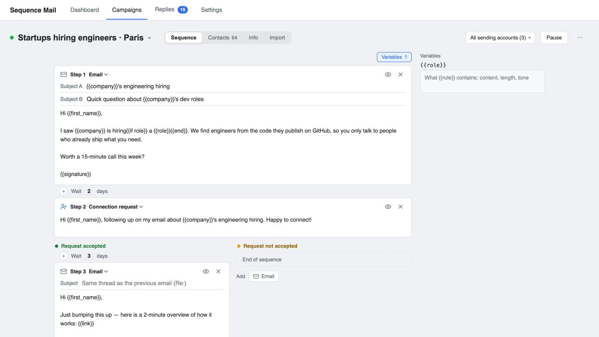
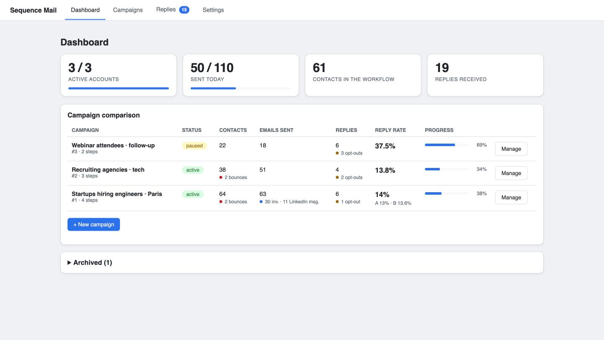
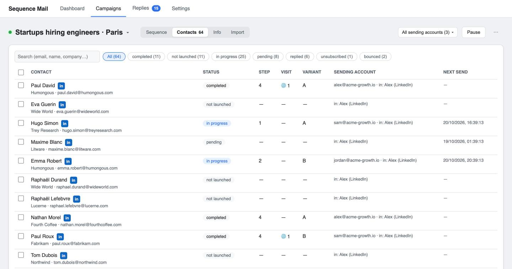
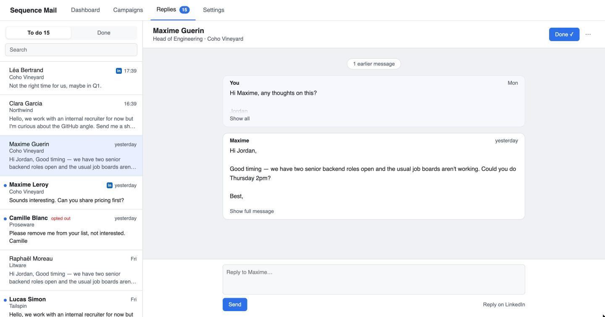
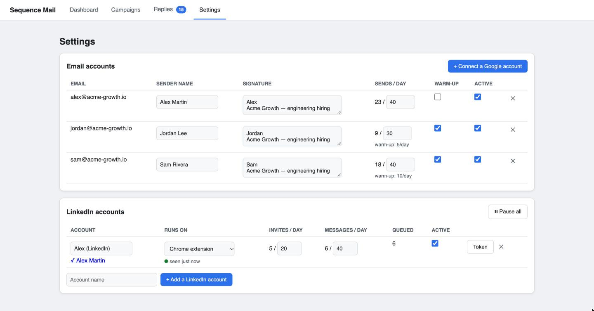

# Sequence Mail

*[Français](README.fr.md)*

**Self-hosted cold outreach: Gmail + LinkedIn sequences, on your own server, driven from Claude.**
A free, open-source alternative to lemlist and Instantly. Your data lives in one SQLite file, and emails go out through the Gmail API of your own accounts.

## ⚡ Install in one command

```bash
curl -fsSL https://raw.githubusercontent.com/jmougeot/sequence-mail/main/install.sh | sudo bash
```

> Works on any Linux VPS with 1 GB of RAM. It installs Docker if needed, pulls the prebuilt image and serves the app over HTTPS. You can skip both questions: without a domain the app runs on `<ip>.sslip.io`, and without a password one is generated.
>
> **Last step:** open **Settings**, paste your Google OAuth client ID and secret (the page links to each Google Cloud screen and shows the redirect URI to copy), then click **Connect a Google account**.

Want to try it locally first?

```bash
docker run -d -p 127.0.0.1:3000:3000 -v sequence-data:/data ghcr.io/jmougeot/sequence-mail
```

Then open http://localhost:3000.

---

## Email and LinkedIn in one sequence



Mix emails, connection requests and LinkedIn messages in one sequence. The sequence branches on whether the connection request was accepted, follow-ups stay in the same Gmail thread, and you can A/B test subject lines. Templates use `{{first_name}}`, any CSV column and `{{if role}}…{{else}}…{{end}}` blocks.

## Every campaign at a glance



See reply rate, A/B results, bounces and opt-outs for each campaign, plus today's sending volume.

## Every contact, every step



For each contact you see their status, current step, sending account and next send, plus visits to their personal tracked link (`{{link}}`). You can launch, stop or move contacts in bulk.

## One inbox for all replies



Inboxes are checked every few minutes. A reply stops the sequence for that contact, and all email and LinkedIn replies land in one to-do list. Opt-outs are detected and blacklisted, bounces are caught, and auto-replies postpone the sequence instead of stopping it.

## Several Gmail accounts, one LinkedIn session



Sends are spread across your Google accounts, with automatic warm-up (5/day, +5 every week), daily quotas, a sending window and random gaps between sends. LinkedIn actions run in your own browser session through a [Chrome extension](extension/README.md), with conservative daily limits.

## 🤖 Run it all from Claude (MCP)

The goal is that you don't need the dashboard day to day. An MCP server ([`mcp/`](mcp/README.md), 42 tools) lets Claude Desktop, Claude Code or any MCP client run the whole workflow:

> *"Create a campaign for CTOs of seed-stage startups, write a 3-step email + LinkedIn sequence, import `leads.csv` and show me the preview."*
>
> *"Who replied since yesterday? Draft an answer to each one."*
>
> *"Pause the agencies campaign and list everyone who bounced."*

Claude creates campaigns, imports contacts and fills their variables, previews every email, reads replies and drafts answers. Nothing goes out without your explicit OK: Claude shows a preview before every launch or reply.

```bash
cd mcp && npm install && npm run build
claude mcp add sequence-mail \
  -e SEQUENCE_MAIL_BASE_URL=https://go.yourdomain.com \
  -e SEQUENCE_MAIL_BASIC_AUTH=admin:yourpassword \
  -- node "$PWD/dist/index.js"
```

---

## Good to know

- **Google setup**: [enable the Gmail API](https://console.cloud.google.com/apis/library/gmail.googleapis.com), set the [Audience](https://console.cloud.google.com/auth/audience) to *Internal* (Workspace) or *External* and "Publish app" (in *Testing* mode connections expire after 7 days), then [create a *Web application* OAuth client](https://console.cloud.google.com/auth/clients/create).
- **LinkedIn**: automating LinkedIn is against its User Agreement and can get an account restricted. Keep the default limits and use it at your own risk. With your own domain, add it to `host_permissions` in `extension/manifest.json`.
- **Custom domain**: create an `A` record `go.yourdomain.com → server IP` (Cloudflare proxy off) before installing. Non-interactive install: `curl -fsSL …/install.sh | sudo DOMAIN=go.yourdomain.com DASHBOARD_PASSWORD=… bash`.
- **Update**: `cd /opt/sequence-mail && docker compose pull && docker compose up -d`.
- **Settings**: everything has defaults. Quotas, sending window, warm-up and LinkedIn limits can be changed in `.env` (see [`.env.example`](.env.example)).
- **Stack**: Node 22, Express and SQLite behind Caddy. State is updated transactionally after every send, so a restart never sends anything twice.

## Development

```bash
npm install && cp .env.example .env && npm run dev   # http://localhost:3000
```

## Contributing

See [CONTRIBUTING.md](CONTRIBUTING.md); report vulnerabilities privately as described in [SECURITY.md](SECURITY.md).

## License

MIT
